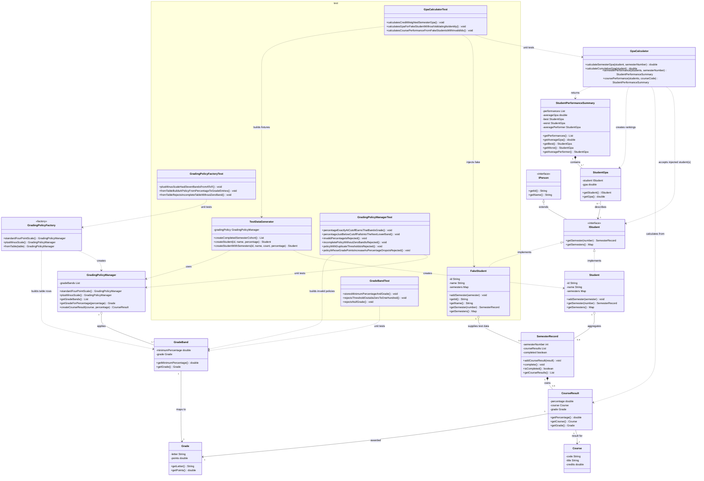

# GPA System UML Class Diagram

The diagram shows production types in `org.example.tdd.gpasystem` and test support types in the test source set. Solid diamonds indicate composition, open diamonds aggregation, solid arrows association, dashed arrows dependency, and hollow triangles interface inheritance or realization.



## Behavior and constraints

- **Student and semester records:** `Student` implements `IStudent`, which extends `IPerson`. A student can have semester records numbered 1 through 8.
- **Semester records and results:** A semester owns its course results. An in-progress semester may contain fewer courses, but `complete()` requires four or five courses and prevents further additions.
- **Courses:** A `Course` has a code, a title, and credits greater than zero.
- **Grading:** `GradingPolicyManager` maps percentages to grades using a table of `GradeBand`s. `GradingPolicyFactory` builds policies: `standardFourPointScale()` gives A-F, `fromTable(...)` accepts a custom table, and `plusMinusScale()` gives A, A-, B+, B, B-, C+, C, C-, D+, D, F. A policy must be non-empty, contain a band starting at 0, have unique thresholds and letters, and never give more points to a lower percentage. `CourseResult` stores the course, percentage, and grade.
- **GPA calculation:** `GpaCalculator` calculates credit-weighted semester and cumulative GPAs. Cumulative GPA and course-performance comparisons use completed semesters only.
- **Performance summaries:** `StudentPerformanceSummary` contains student GPA results, the best and worst performers, the arithmetic average GPA, and the student whose GPA is closest to the average.
- **Test support:** `FakeStudent` allows tests to isolate calculator behavior from production student validation. `GradingPolicyManagerTest`, `GradingPolicyFactoryTest` and `GradeBandTest` verify cutoffs, `Math.nextDown` just-below values, invalid percentages, and invalid policies.

## Test-Driven Development

The grading policy tests follow the Red-Green-Refactor cycle:

1. **Red:** Write a test for the expected grading behavior and confirm it fails.
2. **Green:** Implement the minimum functionality to make the test pass.
3. **Refactor:** Improve the implementation while keeping all tests passing.

Run the test suite from the project root:

```bash
mvn test
```
