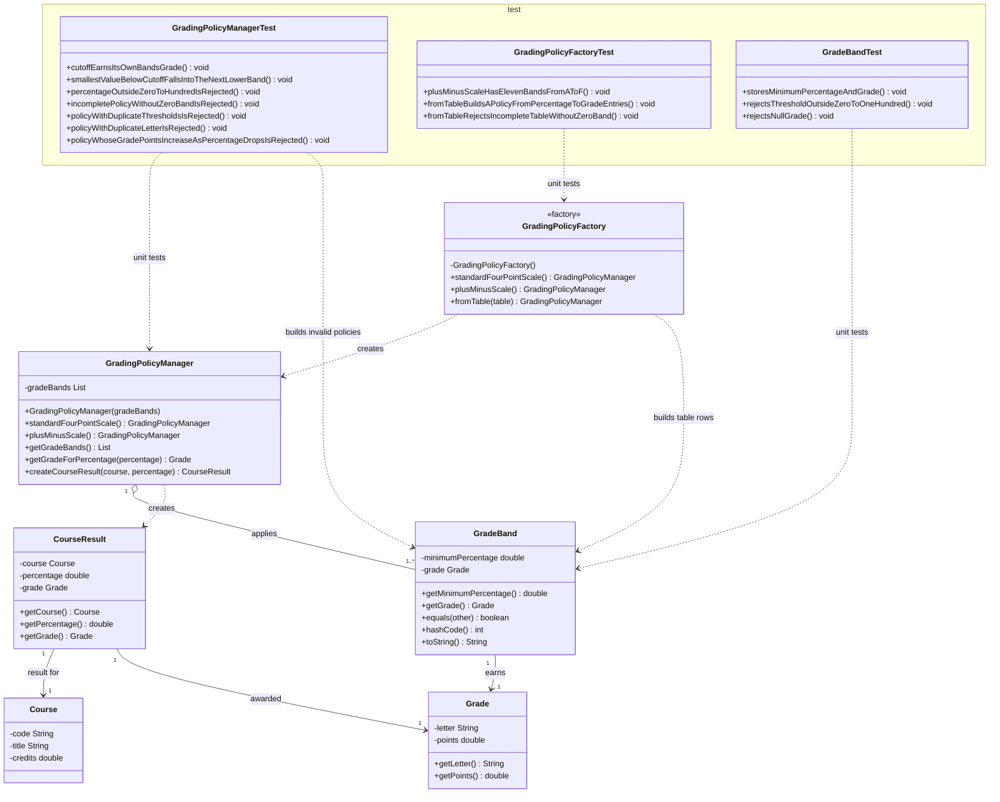

# Question 1 UML Class Diagram: Plus/Minus Grading Scale

This diagram focuses only on Question 1: the plus/minus grading scale (`GradeBand`, `GradingPolicyManager`), the grading policy factory (`GradingPolicyFactory`), and the tests that cover them. The full system diagram is in [GpaSystemClassDiagram.md](GpaSystemClassDiagram.md).

Solid diamonds indicate composition, open diamonds aggregation, solid arrows association, and dashed arrows dependency.

## Plus/minus percentage-to-grade table

| Cutoff (minimum %) | Grade | Points | Just below the cutoff (`Math.nextDown`) |
|-------------------:|:-----:|-------:|:----------------------------------------|
| 93 | A  | 4.0 | A-  |
| 90 | A- | 3.7 | B+  |
| 87 | B+ | 3.3 | B   |
| 83 | B  | 3.0 | B-  |
| 80 | B- | 2.7 | C+  |
| 77 | C+ | 2.3 | C   |
| 73 | C  | 2.0 | C-  |
| 70 | C- | 1.7 | D+  |
| 67 | D+ | 1.3 | D   |
| 60 | D  | 1.0 | F   |
| 0  | F  | 0.0 | invalid (below 0) |

## What Question 1 asks and where it is covered

| Question 1 requirement | Production code | Tests |
|---|---|---|
| Plus/minus grades such as A-, B+, C- | `GradingPolicyFactory.plusMinusScale()` | `GradingPolicyFactoryTest`, `GradingPolicyManagerTest` |
| `GradeBand` | `GradeBand` | `GradeBandTest` |
| `GradingPolicyManager` | `GradingPolicyManager` | `GradingPolicyManagerTest` |
| Grading policy factory for a defined percentage-to-grade table | `GradingPolicyFactory` (`fromTable`, `plusMinusScale`, `standardFourPointScale`) | `GradingPolicyFactoryTest` |
| Scores exactly at each cutoff | `GradingPolicyManager.getGradeForPercentage` | "Scores exactly at each cutoff" tests |
| Scores just below each cutoff | `GradingPolicyManager.getGradeForPercentage` | "Scores just below each cutoff" tests (`Math.nextDown`) |
| Invalid percentages | percentage check in `getGradeForPercentage` and `GradeBand` | "Invalid percentages" tests |
| Incomplete or invalid policy | validation in the `GradingPolicyManager` constructor | "Incomplete or invalid policy" tests, `GradingPolicyFactoryTest` |

## Policy rules enforced by `GradingPolicyManager`

- The table must not be null, empty, or contain a null band.
- Thresholds must be unique and each between 0 and 100.
- Grade letters must be unique.
- A band starting at 0 must exist, so every valid percentage has a grade (an incomplete policy is rejected).
- Grade points must never increase as the threshold decreases.
- Percentages outside 0 to 100, NaN and infinity are rejected.
